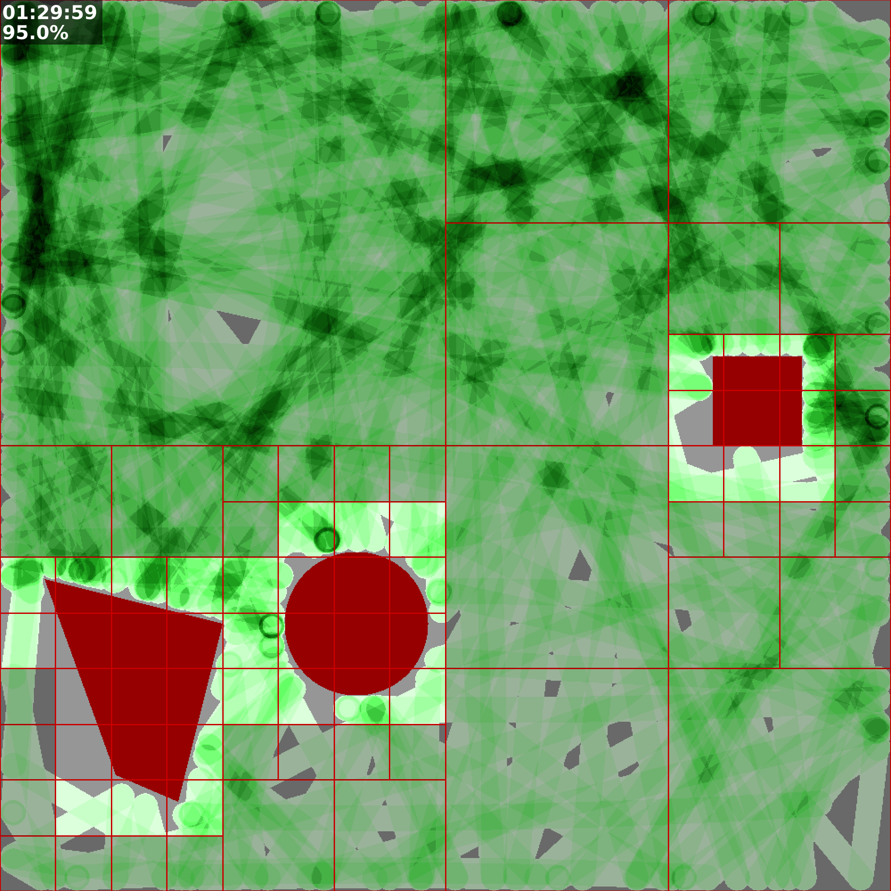

# Documented projects

## 📚 libhpdftbl

Table creation library for Haru PDF.   
See: [libhpdftbl](https://github.com/johan162/hpdf_table)

1. [HTML](libhpdftbl/html/index.html)
2. [PDF](libhpdftbl/lihpdftbl_manual_v1.0.0-beta.pdf)

## 📚 themeltspice

A theme creator for LTSpice SPICE simulation program.   
See: [themeltspice](https://github.com/johan162/themeltspice)

1. [HTML](themeltspice/README.md)
2. [PDF](themeltspice/README.pdf)

## 📚 mptools

A set of tools to help create `multipass` virtual nodes.
See: [mptools](https://github.com/johan162/mptools)

1. [HTML](mptools/html/index.html)
2. [PDF](mptools/mptools_manual.pdf)

## 📚 bayescalc2

A powerful baysian network claculator with interactive REPL loop

See: [BayesCalc2](https://johan162.github.io/bayescalc2/)

## 📚 oneselect

OneSelect uses a probabilistic model based on the Bradley-Terry model (a specific form of the Thurstone-Mosteller model) combined with Bayesian inference to estimate the relative value or complexity of features.

It is a general implementation of an AHP algorithm too allow an efficient pairwise comparison that
achieves a partial ordering withou the full (combinatorical) intractable number of comparisons.

### Usage

A common use case might be to rank features vs. complexity where the product team achieves a partial product 
value ranking of the features and a development team ranks technical complexity. The commbination space
then gives a view of the valuable features to implment.

See: [OneSelect](https://johan162.github.io/oneselect/)

## 📚 mcprojsim

**Stop guessing deadlines. Start simulating them.**

MCProjSim runs thousands of Monte Carlo simulations on your project plan and turns uncertain task estimates into confidence-based delivery forecasts — so you can tell stakeholders "we have a 90 % chance of finishing by March 2nd" instead of "it'll take about 10 weeks".

### Online HTML Rendering

1. [HTML MCProjSim](https://johan162.github.io/mcprojsim/)

### User Guide PDF B5 Rendering

1. [PDF User Guide B5 Light Background](mcprojsim/mcprojsim_user_guide-b5-0.15.2.pdf)
2. [PDF User Guide B5 Dark Background](mcprojsim/mcprojsim_user_guide-dark-b5-0.15.2.pdf)

### User Guide PDF A4 Rendering

1. [PDF User Guide A4 Light Background](mcprojsim/mcprojsim_user_guide-a4-0.15.2.pdf)
2. [PDF User Guide A4 Dark Background](mcprojsim/mcprojsim_user_guide-dark-a4-0.15.2.pdf)

### REST API Guide B5 Rendering

1. [API Guide B5 Light](mcprojsim/mcprojsim_api_ref-b5-0.15.2.pdf)
2. [API Guide B5 Dark](mcprojsim/mcprojsim_api_ref-dark-b5-0.15.2.pdf)

### REST API Guide A4 Rendering

1. [API Guide B5 Light](mcprojsim/mcprojsim_api_ref-a4-0.15.2.pdf)
2. [API Guide B5 Dark](mcprojsim/mcprojsim_api_ref-dark-a4-0.15.2.pdf)

## 📚 gridcover

A physically highly accurate robotic lawn mower simulator. It is written in Rust and
allows simulation of 100x100m with 1cm resolution to be done &lt; 3min on a standard 
laptop. To achieve this performance it uses an optimized quad-tree obstacle detection 
algorithm.

## PDF Rendering

1. [README](gridcover/README.pdf)
2. [Quick Start Guide](gridcover/user-guide.pdf)

## 📚 exchange-intro

An introduction to how exchanges work for people with no financial background.
Choose the format that suits you best. If you have accesst´to an ebook reader we
recomment the **EPUB** rendering as that gives you freedom to choose font size and
background color.

The latest version is a pre-release of the second edition that is awaiting editor
review so expect errors, typos, or other problem. 

[Available versions](exchange_intro/index.md)

